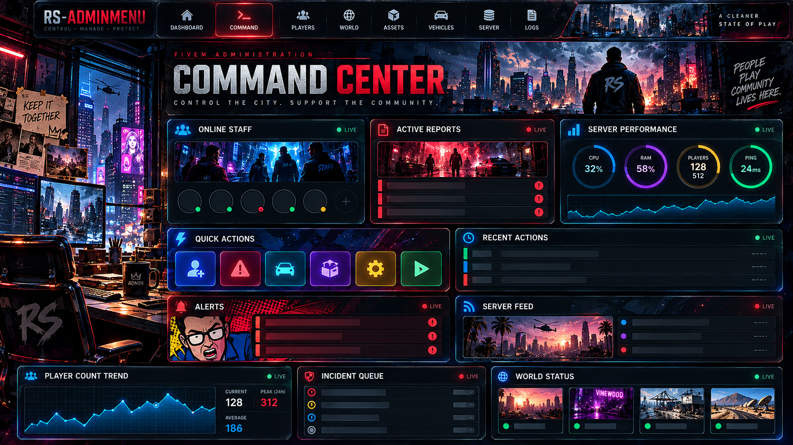
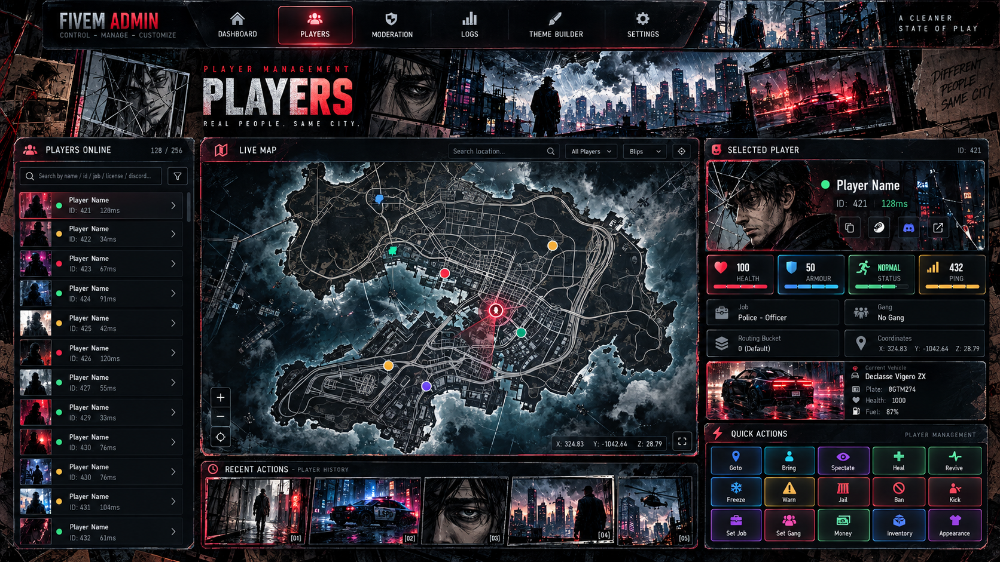
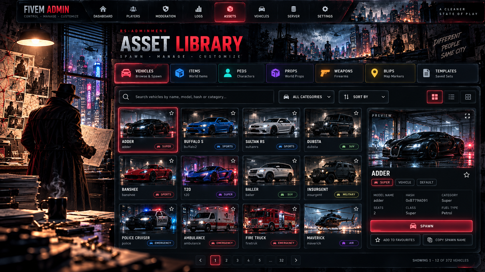
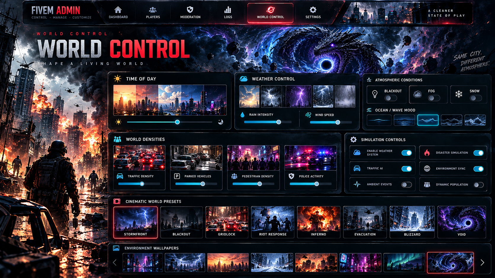
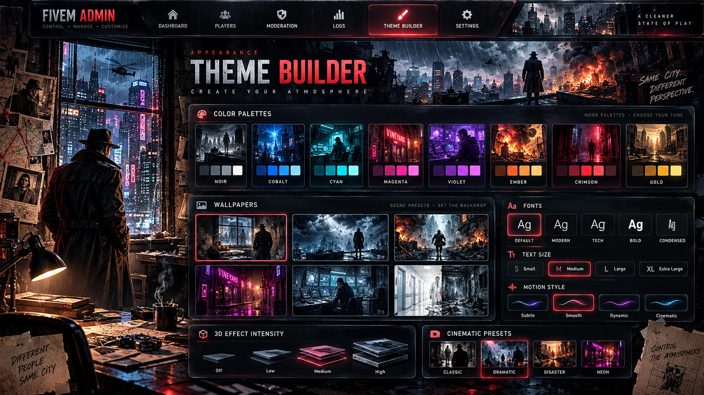

# RS Admin Menu

A FiveM command center for player management, moderation, reports, staff tools, vehicles, world controls, themes, and optional Pathways onboarding.

[Download ZIP](https://github.com/RealitySucksRP/rs-adminmenu/releases/latest/download/rs-adminmenu.zip) · [GitHub](https://github.com/RealitySucksRP/rs-adminmenu) · [Website](https://realitysucksrp.github.io/) · [Store](https://reality-sucks-rp-webstore.tebex.io/) · [Discord](https://discord.gg/e9V3rPHySx) · [YouTube](https://www.youtube.com/@RealitySucksRP) · [Free scripts](https://reality-sucks-rp-webstore.tebex.io/category/free-scripts)

More concept artwork

Open the tablet with /rsadmin or F7, the quick menu with /fadminmenu, and duty controls with /aduty. Back up live data and settings before updating.

[Package documentation](PACKAGE-README.md) · [Installation](INSTALL.md)
