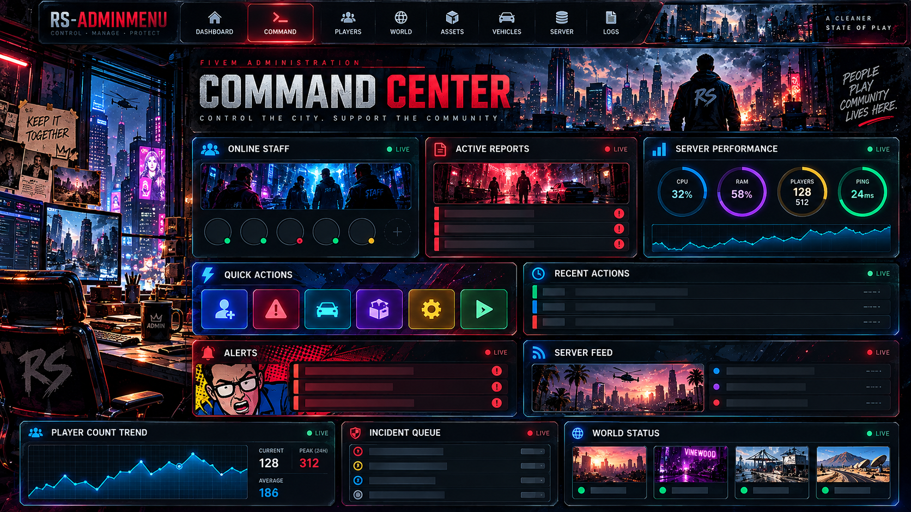
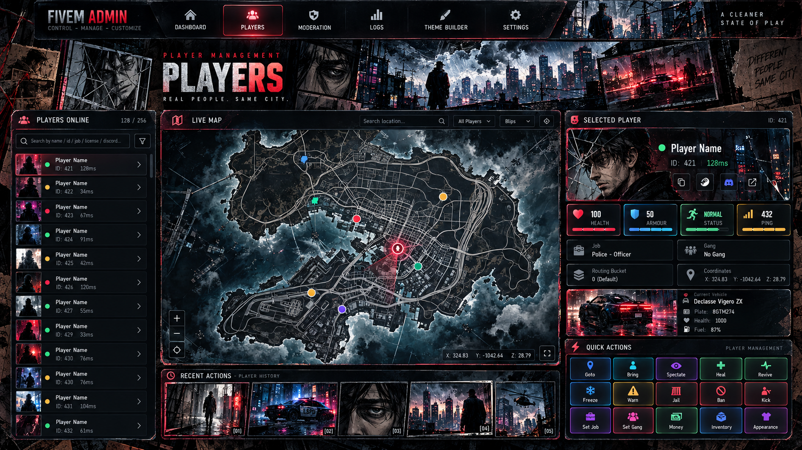
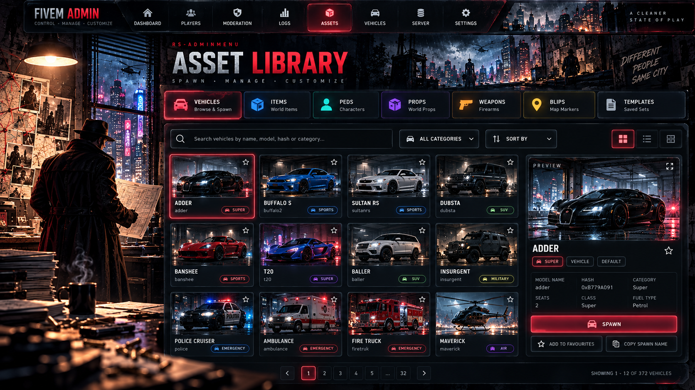
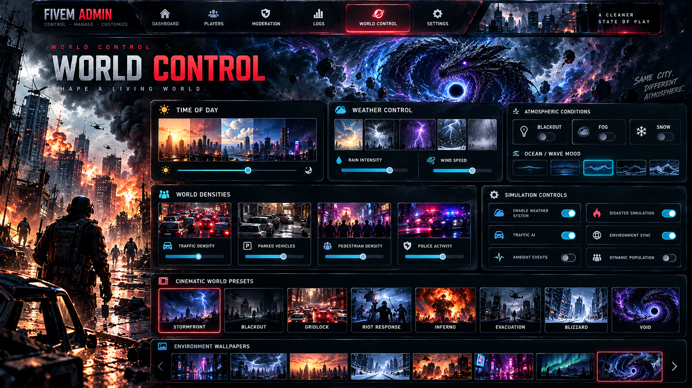
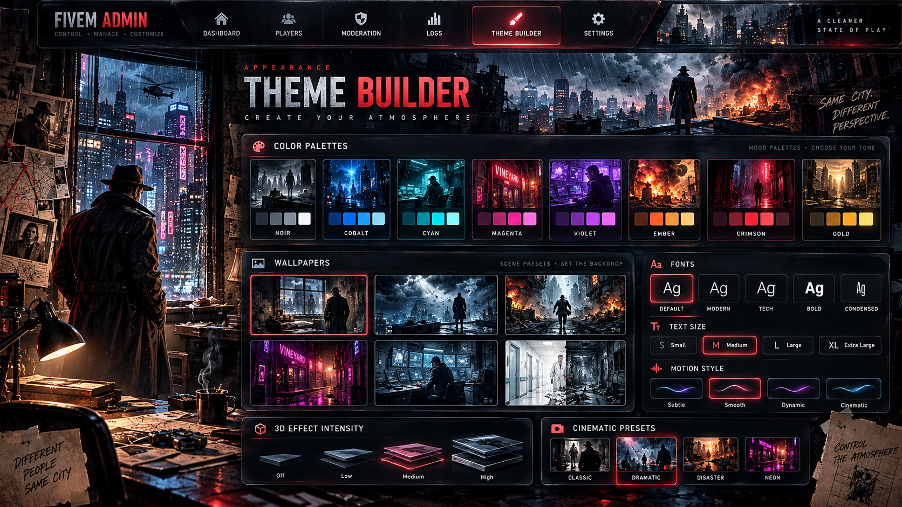

# RS Admin Menu 0.14.2

An in-game control center for server owners and staff: manage players, moderation, reports, staff groups, vehicles, world controls, themes and quick actions. Optional RS Pathways adds onboarding and role-certification tracks. Framework and provider integrations are handled within the resource.

[Download original ZIP](https://github.com/RealitySucksRP/rs-adminmenu/releases/latest/download/rs-adminmenu.zip) | [GitHub source](https://github.com/RealitySucksRP/rs-adminmenu) | [Website](https://realitysucksrp.github.io/) | [Tebex Store](https://reality-sucks-rp-webstore.tebex.io/) | [Discord](https://discord.gg/e9V3rPHySx) | [YouTube](https://www.youtube.com/@RealitySucksRP) | [Free scripts](https://reality-sucks-rp-webstore.tebex.io/category/free-scripts)

> **Upgrading:** keep your live `data/` directory. The full ZIP contains empty first-install stores and must not replace existing player, staff or moderation data.



*Bundled interface concept artwork; included previews are not evidence of a live FiveM test.*

<details>
<summary>More bundled interface concept artwork</summary>









</details>

## Package documentation

# rs-adminmenu v0.14.2

RealitySucksRP advanced in-game Admin Control Center for FiveM. It is built around a cinematic top-navigation UI with player management, moderation, live map controls, reports, staff tools, vehicles/items, world controls, logs, server tools, themes, quick actions, and the optional RS Pathways onboarding/certification system.

## 0.13.0 — Cinematic workspaces and working action flow

- Full-width responsive interface with Dashboard, Command, Players, Assets, Vehicles, World, Moderation, Staff, Logs, Server and Theme workspaces; 4K controls scale with the viewport.
- Command exposes the existing 20 operator powers, noclip, entity laser, coordinates, recovery, vehicle and weapon tools. Operator actions recheck current server permission.
- Fixed the collapsed dashboard grid and the root `data-page` click interception that prevented item selection and action buttons from working.
- Player workspace includes a roster, atlas, live profile and 15 permission-filtered quick actions. Catalogs include favorites, list/grid views, current-page filters and selected-asset details.
- Theme Builder has illustrated palette cards and all 13 existing wallpapers. Search inputs survive live refreshes.
- Qbox heal/revive uses `qbx_medical`; active `rs-garage` supplies the garage list. Private JSON data is no longer included in client files.
- Source and live validation, exact changed files and remaining audit findings are in `AUDIT_AND_LIVE_TESTS_0.13.0.md`. Cleanup, report identity and persistence findings remain open; the live checks do not certify those features.

After installing changed files, run `refresh`, then `restart rs-adminmenu`, and open `/rsadmin`. The bundled atlas has an explicit manifest entry. Optional atlas fallbacks use already-running `rs-tablet` or `rs-zombiephone` while an existing client still has an older asset pack.

## 0.14.2 — Tebex release safety and regression guards

- First-install release archives include empty JSON stores. Existing server `data/` is **not** included in upgrade patches. Never replace live `data/` when updating.
- Expired custom staff roles are denied immediately when permissions are checked, not only when the scheduled cleanup runs.
- Rejected/malformed admin RPCs are bounded and rejection audit/webhook emission is throttled per connection. Successful actions retain their existing auditing.
- Public player reports have a configurable capacity, with oldest **closed** reports pruned before any active ticket would be removed.
- Delayed menu and quick-menu authorization responses cannot reopen the tablet after close, dock, logout or cleanup.
- Lua console documentation now describes its actual checkpoint budget; no promise of a hard CPU instruction limit is made.

## Main features

- Player search, profile, live tactical map, inventory/vehicle inspection, playtime and economy stats.
- Goto, bring, spectate, heal/revive, jail/unjail, jobs/gangs, staff actions and moderation history.
- Online/offline bans, warnings, community service, reports, watchlist, notes and staff chat.
- Image-based item and vehicle databases, owned-vehicle tools, Vehicle Lab and admin cars.
- Weather, announcements, world cleanup, Mini World Builder, disasters and tsunami/maintenance tools.
- Staff groups with ranks, colors, positions and permission-based access.
- Custom dashboard widgets, logs, resource controls, bridge/provider status and quick/radial actions.
- iPhone-style UI motion presets with page springs, sliding tab indicator, sheets, card motion and reduced-motion support.
- English, Spanish, Portuguese, French and German locale structure.

## RS Pathways

Pathways is an optional server-authoritative progression system for onboarding and role certification. Included starter tracks are Citizen Orientation, Police Academy and EMS Orientation. The owner can create/edit tracks, steps, points, prerequisites, rewards, forced/optional assignment and certification from the admin menu.

Player tracking can use any combination of:

- inventory checklist card;
- normal notifications;
- GPS/objective routing;
- `/pathway` status command;
- optional small native-text HUD.

All player-facing tracking is display-only. Progress, points, rewards and certification are controlled by the server.

Turn the entire system off with:

```lua
Config.Pathways.Enabled = false
```

Individual tracking methods can be enabled/disabled under `Config.Pathways.Tracking`, `Config.Pathways.GPS` and `Config.Pathways.MiniHUD`.

### Pathway guide items

If you want the checklist item, copy the appropriate example from:

```text
install/pathway_items.lua
```

into your active inventory item list. The included examples are:

- `citizen_guide`
- `police_guide`
- `ems_guide`

The item only displays server progress; possession never grants certification.

For provider/resource milestones such as opening inventory, creating a bank account, retrieving/storing a vehicle, fuel, emotes, police or EMS training actions, use the server-side examples in:

```text
install/pathway_hooks.lua
```

Location, online-time, proximity, job, gang, item, money and owned-vehicle validators can be checked directly by rs-adminmenu.

## Install

**Upgrading an existing server:** Back up the entire resource. Copy only the files from `rs-adminmenu-0.14.2-update-patch.zip`; do not overwrite your live `data/` directory. A clean full package is intended for a **new installation only**.


1. Place `rs-adminmenu` in your resources folder.
2. Configure `config.lua` for your server and optional Pathways tracks.
3. If using Pathway guide items, add the item definitions from `install/pathway_items.lua` to your inventory.
4. Add only the provider hooks you actually use from `install/pathway_hooks.lua` to the successful server-side actions in those resources.
5. Bootstrap the first Owner with ACE or `Config.OwnerIdentifiers`.
6. Add `ensure rs-adminmenu` after your framework/inventory/garage/key resources.

Minimal solo Owner test configuration:

```cfg
add_principal identifier.license:REPLACE_ME group.rsowner
add_ace group.rsowner rsadmin.owner allow
add_ace group.rsowner rsadmin.all allow
ensure rs-adminmenu
```

Open the full menu with `/rsadmin` or F7. Quick menu: `/fadminmenu` or F10. Duty: `/aduty`.

## Important notes

- Qbox is the priority framework, followed by QBCore, ESX and standalone/ACE paths where supported.
- Sensitive actions are checked again on the server; the NUI is not trusted for permissions, money, inventory, bans, vehicle ownership or Pathways completion.
- High-water tsunami states can require a resource/server restart for guaranteed full water restoration.
- Catalogs, history and logs are lazy/paginated to avoid loading large datasets when the menu opens.


## Server Requirement

OneSync/state awareness must be enabled. The resource checks this requirement through its manifest. Legacy and Enhanced support need live validation on your selected server artifact and game build.

## Admin Tablet

Open the admin menu with `/rsadmin`.

The admin interface is displayed inside the included tablet frame. Use the top navigation and section selector to move between Command, Players, Assets, Vehicles, World, Moderation, Staff, Logs, and Server tools.

## 0.12.3 — Qbox character-selection NUI hardening

- NUI starts hidden; server bootstrap only supplies data and cannot reopen an intentionally closed menu. The UI opens only on an explicit `uiMode:FULL` client message.
- Startup failsafe and redundant hidden states do not call the NUI focus API while Qbox multicharacter is active.
- HTML viewport transparency is explicit, and the browser dark color-scheme hint has been removed. The tablet itself remains visually unchanged.
- Run `/rsadminnuidiag` in F8 to print Chromium document/body background and root visibility without opening the menu.
- To isolate remaining gray-screen behavior, check the console output *while the screen is gray*. A transparent, hidden NUI with the gray screen still present needs an actual FiveM CEF/compositor or multicharacter integration test.
- No database schema, permissions, resource exports, or feature behavior was changed.

